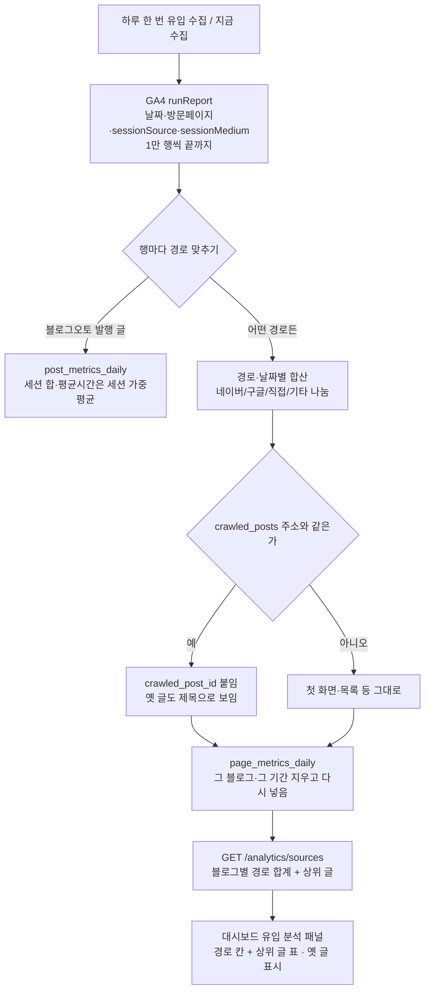

# 유입 경로 · 옛 글 수집 (2026-10-14, 마케팅 B1·B2)

기존 `post_metrics_daily`(블로그오토 발행 글 × 날짜)는 그대로 두고, **블로그의 모든
방문 페이지**를 유입 경로(네이버/구글/직접/기타)별로 따로 적는다. 블로그오토가 쓰지
않은 옛 글(인생꿀팁 수작업 글 등)과 첫 화면까지 빠짐없이 잡힌다.

옛 글을 `search_visibility_urls` 에 넣지 않는 이유: 그 표는 색인 되먹임(발행 상한)·
재발행·문체 선택이 함께 본다. 옛 글이 섞이면 발행 상한과 재발행 판정이 흔들린다.

경로 판정(`channels.classify_channel`)
- `(direct)` → 직접
- source 에 `naver` → 네이버
- source 에 `google` → 구글
- 나머지(다음·빙·추천 사이트·AI 등) → 기타
