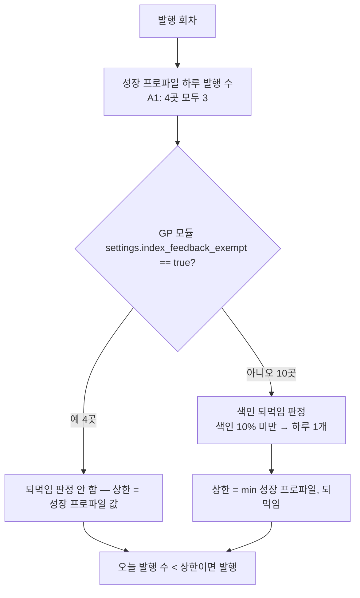
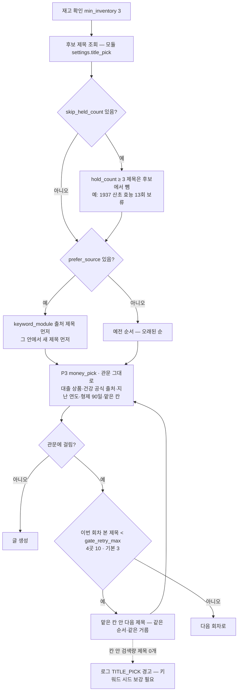

# 승인 4곳 A1 — 하루 3편 · 검색량 제목 먼저 · 관문 다음 제목 10개 (2026-11-02, 마케팅 지시·형 승인)

근거: cheshirecat-app/data/프로젝트/마케팅/보고/2026-11-02_블로그오토_발행수·제목수집생성_점검.md 1장·3장 A
대상: 인생꿀팁 14 · 잡학다식 9 · 굿팁꿀팁 7 · 꿀팁대백과사전 8. 나머지 10곳은 지금과 같다(스위치가 없으면 예전 동작).

## 발행 상한 — 색인 되먹임에서 빼기

- 예전: 10/25 P1 로 2로 올렸지만 되먹임이 min(2,1)=1 로 덮어 4곳 모두 하루 1편.
- 발행 시각은 interval_mode=auto(활성 24시간 ÷ 하루 수 = 약 8시간 간격 + jitter)라 하루에 고르게 퍼진다.

## 생성 회차에서 제목 고르기

- 칸 안 검색량 제목은 11/2 기준 인생꿀팁 212 · 잡학다식 144 · 굿팁꿀팁 311 · 꿀팁대백과 184개(관문 바로 걸릴 것 뺀 수)라
  하루 3편이면 한 달 넘게 버틴다. 자동 시드 채우기는 0개 경고가 나면 따로 만든다.
