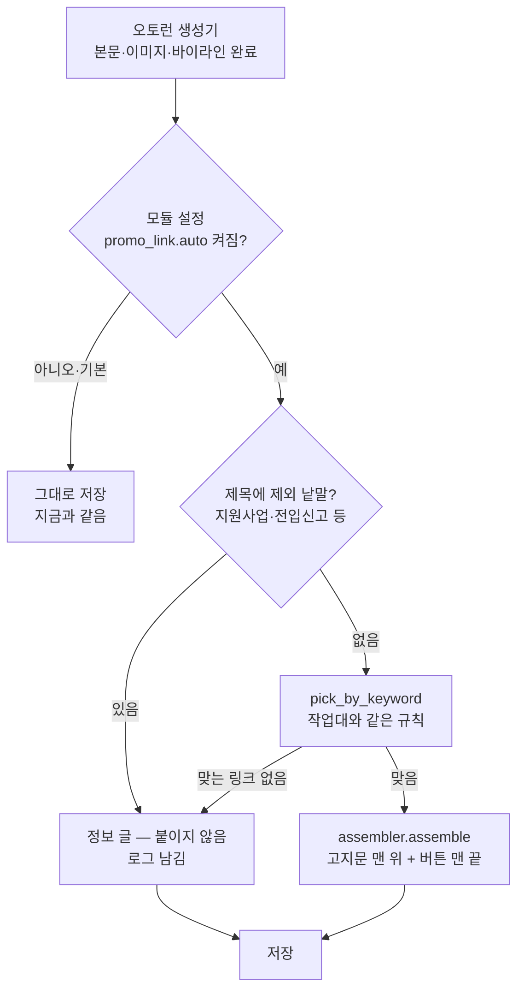
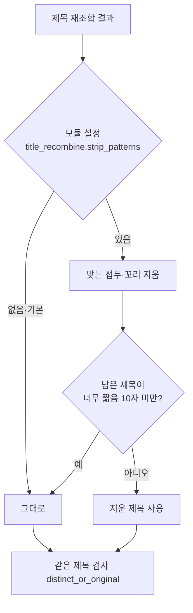

# 오토런 글에도 홍보 링크를 붙인다

## 무엇이 빠져 있었나 (2026-10-18)

이사노트(블로그 21)의 업체 글에 '이사 견적 무료 비교하기' 버튼이 10/5
공개분부터 사라졌다. 고장이 아니라 **길이 바뀐 것**이었다.

- 9/23까지: 글을 모듈 테스터(작업대)에서 손으로 만들었다. 조립
  (`/workbench/assemble`)이 제목 키워드로 링크를 골라 고지문·버튼을 붙였다.
- 9/26부터: 오토런(모듈 206)이 글을 만든다. 오토런 생성기에는 링크를
  붙이는 단계가 **처음부터 없었다.** 미리 만들어 둔 손글이 10/4까지
  나가서 10/5부터 빈 자리가 드러났다.

## 흐름

- 고르는 규칙과 조립은 작업대와 **같은 함수**를 쓴다. 미리보기와
  오토런 결과가 갈리지 않는다.
- 링크 목록(`promo_links`)은 블로그를 비워 두면 모든 블로그에서 쓰인다.
  그래서 **모듈 스위치가 켜진 모듈만** 붙인다(기본 꺼짐). 이사 낱말이
  들어간 다른 블로그 글에 이사 버튼이 붙지 않는다.
- 제외 낱말은 모듈 설정 `promo_link.exclude` 로 둔다. 키워드로는 업체
  글처럼 보이지만 실은 정보 글인 것(수급자 이사비 지원사업 등)을 거른다.
- 링크 붙이기가 실패해도 글 생성은 계속한다(링크 없이 저장, 경고 로그).

## 제목 틀 정리 (같은 날)

'이사 견적 받았다면…' 접두와 '…이 적정한가', '이대로 괜찮은 걸까요',
'다 됐나' 꼬리가 기계적으로 붙었다. 원인은 모듈 206 제목 지시
(감성형 = "견적을 받은 상황을 조건절로", 질문형 = "값이 적정한지 묻는
형태")였다. 지시문을 고치고, 그래도 붙으면 지우는 안전장치를 둔다.

