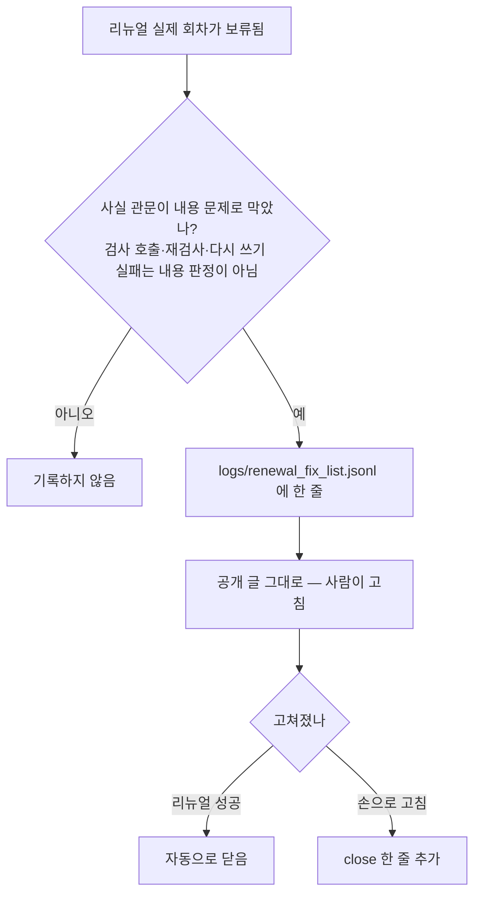
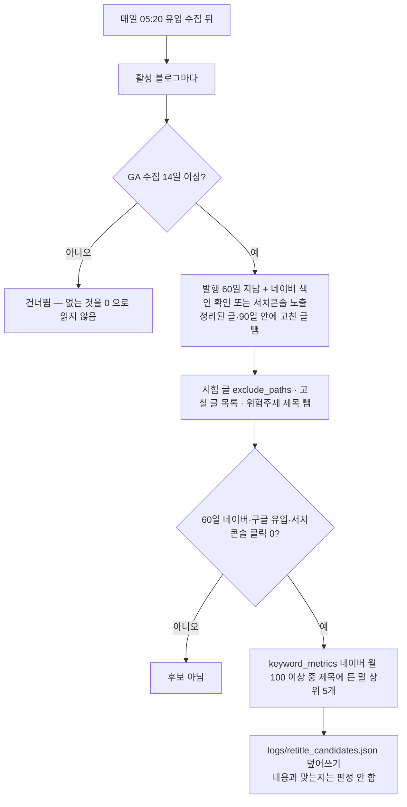

# 제목 재조합 후보 목록 · 고칠 글 목록 (2026-11-07, 1단계 — 글은 고치지 않는다)

형 승인 11/7. 검토: cheshirecat-app/data/프로젝트/블로그오토/보고/2026-11-07_사실수정9편·제목재조합_자동화검토.md 3장.
자동 재조합(2단계)은 12/5 시범 채점 뒤 판단한다. 여기는 **목록만** 만든다. AI 호출 0원.

## 1. 고칠 글 목록 (renewal_fixlist.py)

## 2. 제목 재조합 후보 목록 (retitle_candidates.py)

- 블로그오토 전 옛 글은 search_visibility_urls 이력이 없어 네이버 색인을 몰라 후보에 안 든다.
- 맞는 검색어가 없는 글도 목록에 남기고 keywords 를 비운다(시범의 '기록만').
