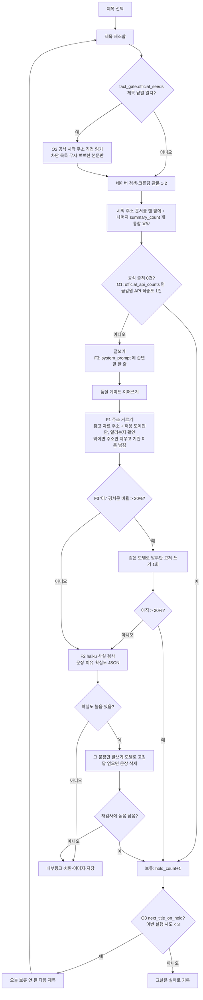

# 사실 관문(F1·F2·F3)과 공식 출처 보류 개선(O1·O2·O3)

> 2026-10-20 마케팅 지시(형 승인 '전부 추천대로') — 슈마즈(블로그 15·모듈 177)만.
> 근거: 슈마즈 클로드 시험(sonnet 신협 오류, haiku 가짜 주소·틀린 절세 조언·'~다' 말투, 6개 중 4개 공식 출처 0건 보류).
> 모든 기능은 모듈 설정 최상위 키 `fact_gate` 가 있을 때만 동작한다. 없으면 지금과 같다.

## 설정 (모듈 177 `settings.fact_gate`)

| 키 | 뜻 |
|---|---|
| `url_allowlist.enabled/domains/check_alive` | F1. 도메인은 하위 도메인 포함 |
| `polite_tone.enabled/max_ratio` | F3. 기본 0.2 |
| `fact_check.enabled/provider/model` | F2. 기본 anthropic / claude-haiku-4-5. 검사 호출 실패면 검사 없이 계속(기록) |
| `official_api_counts` | O1 |
| `official_seeds` `[{keywords, urls}]`, `max_seeds` | O2. 기본 최대 3개 |
| `next_title_on_hold.enabled/max_attempts` | O3. 기본 3 |

- 파일: `app/services/generation/fact_gate/`(F1·F2·F3), `official_hold.py`(O1), `app/services/reference/official_seeds.py`(O2), `generation/hold_retry.py`(O3).
- 기록: 로그 `[FACT_GATE]`(지운 주소·뽑힌 문장·고친 결과 JSON), `[OFFICIAL_SEED]`, `[HOLD_RETRY]`. 생성 결과 warnings 에 "F1 주소 n개 삭제·F2 틀린 문장 n개 고침".
