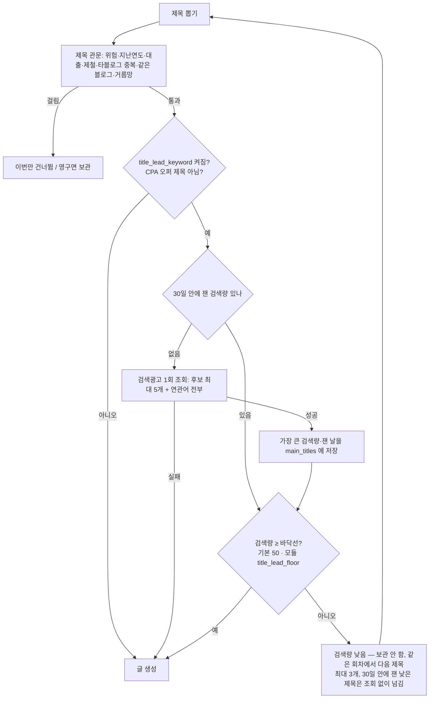
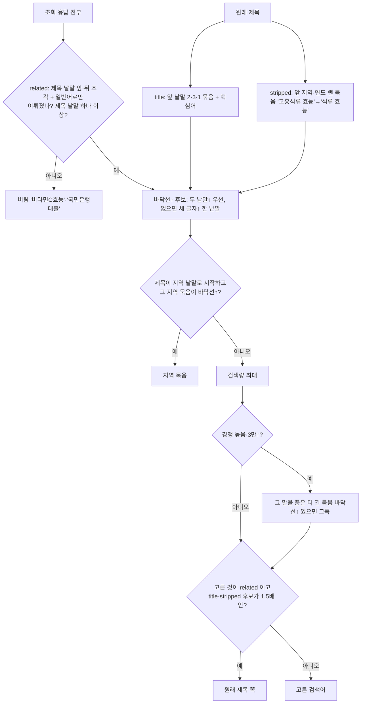
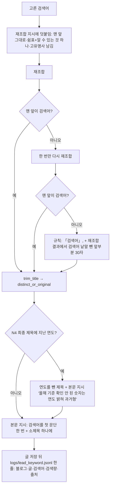

# 검색어 중심 제목 재조합 N1~N4 (2026-10-23, 마케팅 지시·형 승인)

지시서: cheshirecat-app/data/프로젝트/마케팅/보고/2026-10-23_지시서_블로그오토_제목검색어_N1-N4.md

기존 재조합 스타일·프롬프트·trim_title·distinct_or_original·topic_gate·same_blog_dedupe 는
그대로 두고 **앞뒤에 붙인다**. 스위치는 모듈 settings 최상위 `title_lead_keyword` 하나 —
끄면 10/19 이전과 같다(N3·N4 는 스위치와 상관없이 모든 블로그).

코드: `lead_keyword_pick.py`(후보·고르기, 순수) · `lead_keyword.py`(조회·지시·맞춤·기록) ·
`volume_floor.py`(N2 건너뛰고 다음 제목) · `topic_gate.py`(N3 90일·N4 최종 제목)

## 1. 생성 회차 (flow_generate_executor)

## 2. 맨 앞 검색어 고르기 (lead_keyword_pick)

## 3. 재조합·맞춤·기록 (generator)

CPA 오퍼 제목(이사노트 등)은 지시를 붙이지 않고 검색어만 기록한다(N2 바닥선도 안 본다).

N2 '낮음'은 **모든 후보**(넓은 한 낱말 '삼겹살' 14만 포함)가 바닥선 아래일 때만이다.
검색량은 있는데 맨 앞에 쓸 말이 없으면(넓은 한 낱말뿐) 건너뛰지 않고 지시 없이 쓴다.
연관어는 제목에서 온 조각이 둘 이상이어야 한다('컴퓨터 가격'은 '그래픽카드 교체' 글 X).

검색광고가 검색량을 '< 10'으로 가려 보낼 때(2026-10-23부터 실측)는 클릭 ÷ 클릭률로
어림한다(naver_ads_service._count_or_estimate). 경쟁 정도도 '높음·중간·낮음' 한글로 온다.

## 4. N3 블로그끼리 같은 주제 (topic_gate)

- 7일 안: 지금 기준 그대로(바이그램 0.45 또는 낱말 2개↑·0.3)
- 8~90일: 의미 낱말 기준(same_blog_dedupe.is_same, 지역은 지우지 않음, 3개↑ 겹치면 같은 주제)
- 걸리면 이번만 건너뜀(보관 X)
- 같은 블로그: 모든 모듈 `dedupe_same_blog_days: 90`, doooit082.com 4곳은 `dedupe_sibling_sites` (인생꿀팁은 0=전체 기간 유지)
