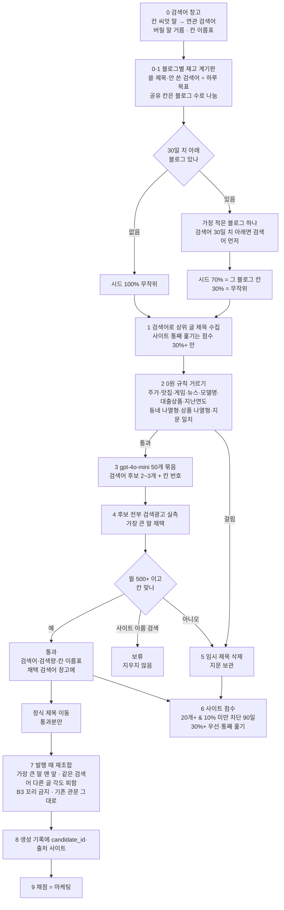
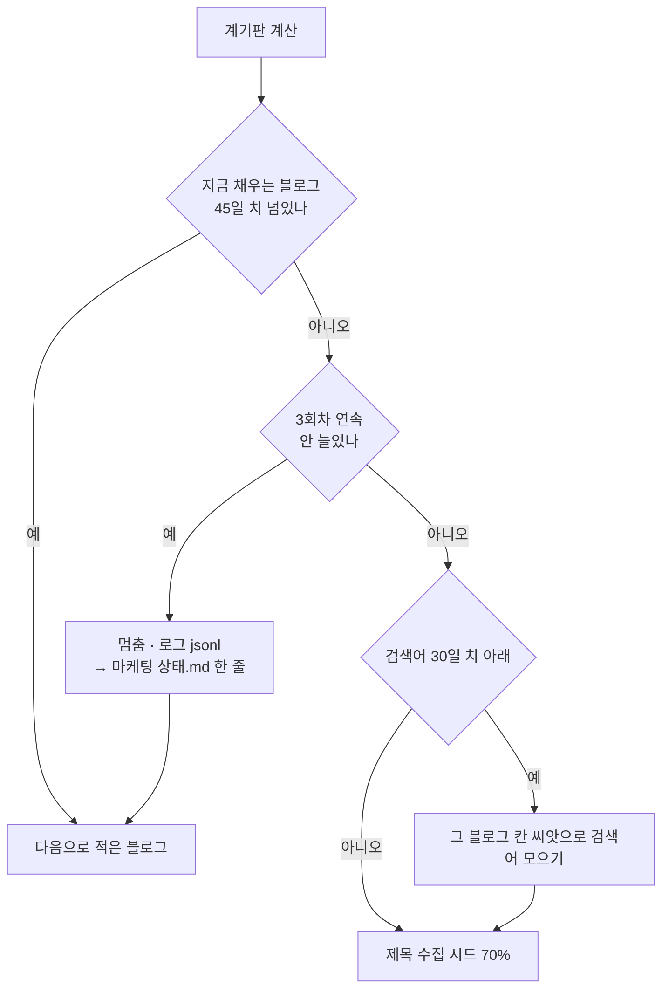
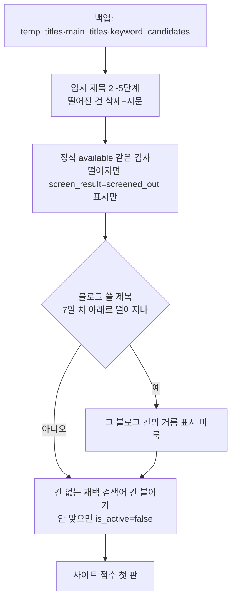

# 제목 D 방식 — 수집·거르기·검색량·사이트 점수·블로그별 재고 (2026-11-02)

설계: 마케팅 `보고/2026-11-02_블로그제목_워크플로우_D방식최종.md` (형 승인 1~4번).
코드: `app/services/title_screen/`, 일회 정리 `scripts/title_screen_cleanup.py`.

## 전체 흐름

## 0-1 채우기 차례 (회차마다)

## 정리(한 번)

되돌리기: 백업 표(`bak_1102_*`) · `screen_result` 지우기 · `title_site_scores` 비우기 · 끈 검색어 다시 켜기.
